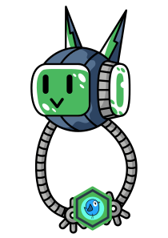
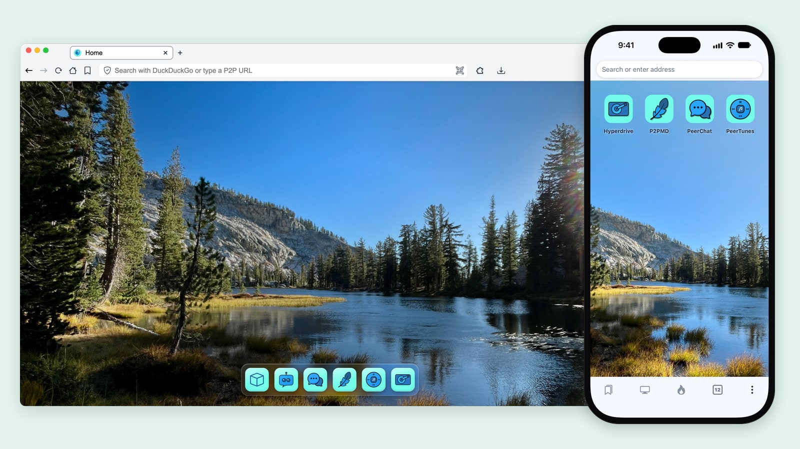
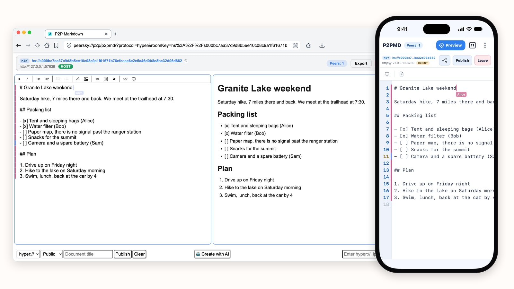
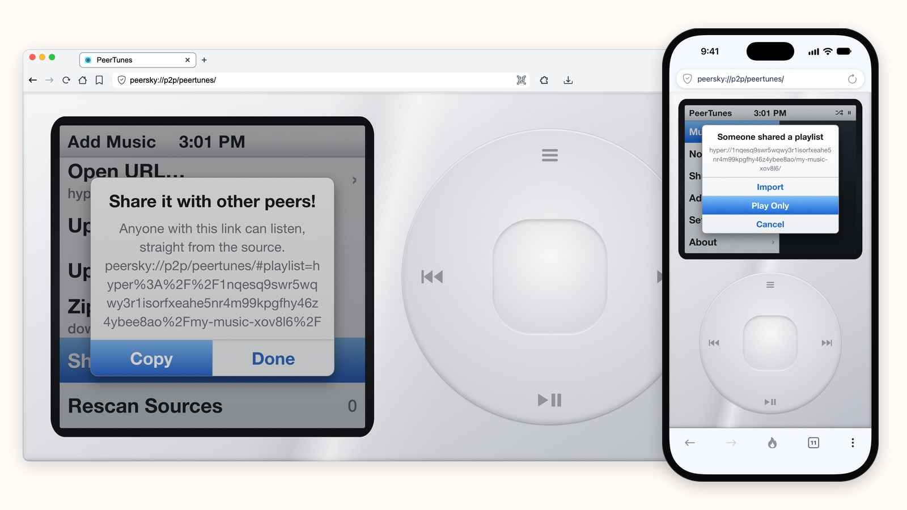
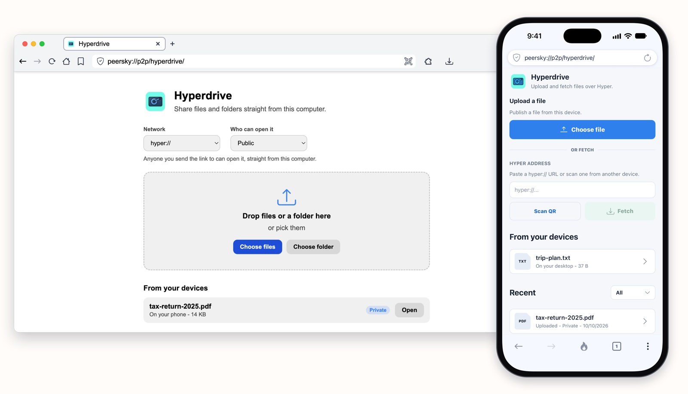
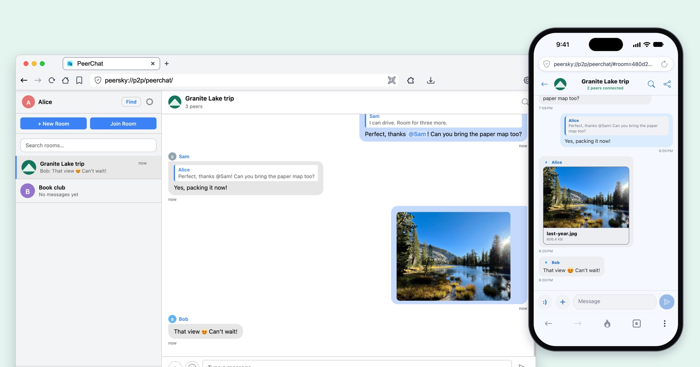
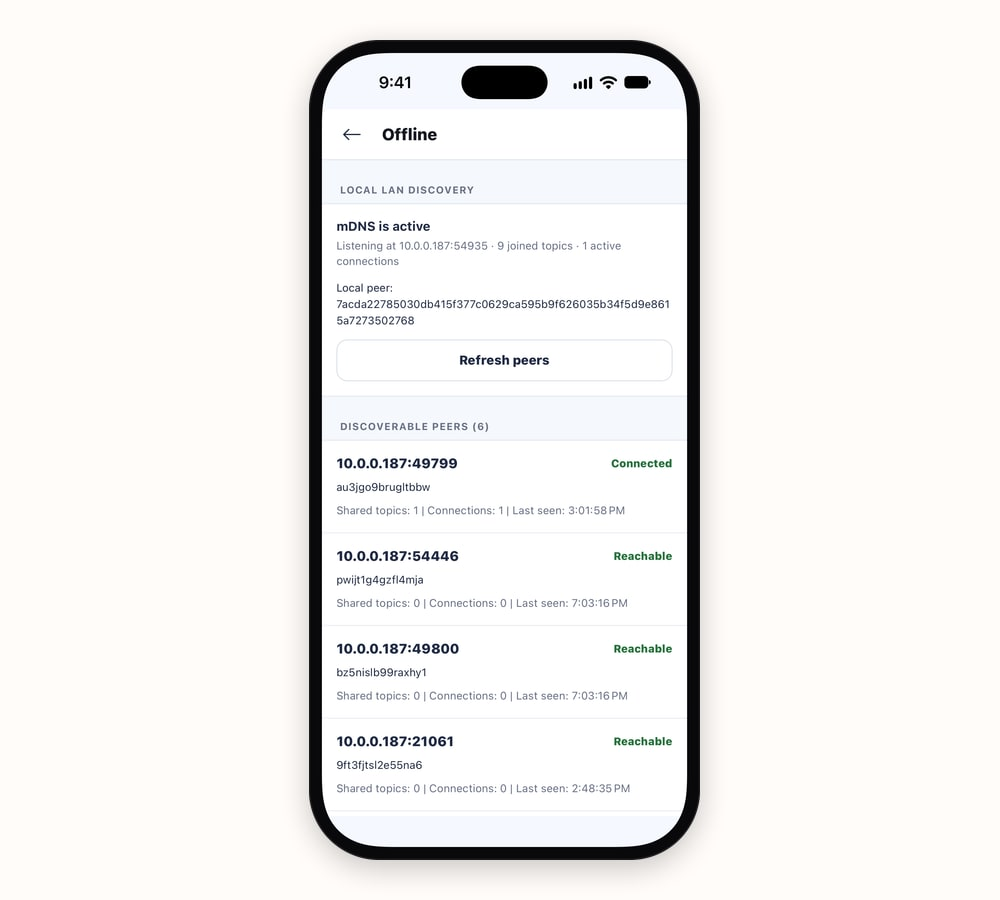

Greetings, fellow peers! We've added a new project to the Dat ecosystem, and this one fits in your pocket. **Let's welcome PeerSky!** It's a browser for your computer and your phone that opens the web and `hyper://` sites alike, built on Hypercore by P2P Labs. Every device running it is a peer: what you make stays on your own devices and goes straight to the people you choose, with no server in the middle.
  

    
  

  

 

PeerSky comes with built-in P2P apps: **PeerChat** for messages, **P2PMD** for notes you write together, **PeerTunes** for music and **Hyperdrive** for files. And [anyone can build more](https://github.com/p2plabsxyz/peersky-browser/blob/main/docs/P2P.md). A P2P app is just HTML, CSS and JavaScript. On the desktop, drop a folder onto `peersky://p2p/` and it sits right next to the built-in apps, or publish it to `hyper://` with a plain `fetch()` call and it opens in PeerSky on any computer or phone.

And it's not just for laptops. PeerSky runs on Android and iOS too, with a full Hypercore node tucked right inside the app. Under the hood it's Holepunch's [Bare](https://github.com/holepunchto/bare) runtime, a [Corestore](https://github.com/holepunchto/corestore) holding your data and [Hyperswarm](https://github.com/holepunchto/hyperswarm) finding other peers over the [HyperDHT](https://github.com/holepunchto/hyperdht). So your phone isn't stuck asking a server for things. It can host a note, share a playlist or keep the group chat going, just like your laptop. And on the desktop, PeerSky speaks a whole bunch of protocols side by side: Hypercore (`hyper://`), IPFS (`ipfs://` and `ipns://`), BitTorrent (`bt://` and magnet links), Holesail (`hs://`) and `web3://`.
  

 

Now let's see what that feels like in real life. Below, we'll follow two friends, Alice and Sam, as they plan a weekend away, and show you how PeerSky helps them make things together, share them straight from their own devices, and keep going when the signal drops.

## Make something together

Alice plans on a laptop and Sam on a phone. They're off to Granite Lake, where the signal gives up long before the trail does, so the plan has to come together before they leave.

In P2PMD, Alice starts a note and the laptop becomes its host. Sam pastes the note's `hs://` key on the phone, or scans it as a QR code, and they write together, live, with every line marked with who wrote it. Underneath sits a [Holesail](https://holesail.io/) tunnel over the HyperDHT and one shared [Yjs](https://yjs.dev/) document, so a laptop and a phone can type at once without losing a word.

## Share it straight from your device

Every PeerSky link carries a key. Open one, and PeerSky finds a device that has the data on the HyperDHT, connects to it directly and checks what arrives against that key. Nothing has to be uploaded anywhere first.

Alice publishes a playlist from PeerTunes to a `hyper://` drive on the laptop, and Sam's phone plays it straight from there, or imports it.

Photos from the summit go into Hyperdrive: public for anyone with the link, or private and encrypted, so only your own devices can open them.

And PeerChat ties the group together. Every message is encrypted, signed by whoever wrote it and passed from device to device, so the conversation stays with the people in it.

## Keep going offline

Phones and computers on the same Wi-Fi find each other with [hyperdht-mdns](https://github.com/p2plabsxyz/hyperdht-mdns), a module P2P Labs wrote for exactly this. Each device announces itself over mDNS, and together they run a small DHT of their own on the local network. Every built-in app uses it. The team tested it the honest way, by unplugging the cable from their modem, and chats, notes and files kept flowing between a laptop and phones in the same room. Whatever you've already opened, hosted or kept offline opens with nothing connected at all.

## Why it matters

Picture a classroom where the internet costs too much, a family far from the nearest tower, a neighbourhood after a storm takes the network down, or friends who'd simply rather their conversations stayed theirs. A browser that works between the devices people already carry can help every one of them. That's the internet PeerSky wants to help save: one where your tools, your data and your connections belong to you.

PeerSky stands on years of work from across the Dat ecosystem, from Hypercore and Hyperswarm to Bare, Holesail and Agregore. If you build on Hypercore, try your app in PeerSky and come say hi on PeerChat. Let's save the internet, one peer at a time! 👋

## PeerSky Links

  

    
  

  

    
Website

    
<a target="_blank" href="https://peersky.p2plabs.xyz/">https://peersky.p2plabs.xyz/</a>

    
Desktop source

    
<a target="_blank" href="https://github.com/p2plabsxyz/peersky-browser">https://github.com/p2plabsxyz/peersky-browser</a>

    
Mobile source

    
<a target="_blank" href="https://github.com/p2plabsxyz/peersky-mobile">https://github.com/p2plabsxyz/peersky-mobile</a>

    
Mastodon

    
<a target="_blank" href="https://mastodon.social/@peersky">https://mastodon.social/@peersky</a>

    
Bluesky

    
<a target="_blank" href="https://bsky.app/profile/peersky.mastodon.social.ap.brid.gy">https://bsky.app/profile/<wbr>peersky.mastodon.social.ap.brid.gy</a>

    
Matrix

    
<a target="_blank" href="https://matrix.to/#/#peersky:matrix.org">https://matrix.to/#/#peersky:matrix.org</a>

    
Discord

    
<a target="_blank" href="https://discord.gg/9kUqxjbEx6">https://discord.gg/9kUqxjbEx6</a>

  

------

### Dat Ecosystem

**Donate to support volunteers & our independent work at Dat Ecosystem
Apereo Foundation: https://www.apereo.org/programs/software/dat-ecosystem**

Stay connected in this jungle of confusion that we call the internet. With so many changes happening, it's important to have outposts in various places.

  
Webpage

  
<a target="_blank" href="https://dat-ecosystem.org/">https://dat-ecosystem.org/</a>

  
Donate

  
<a target="_blank" href="https://www.apereo.org/programs/software/dat-ecosystem">https://www.apereo.org/programs/software/dat-ecosystem</a>

  
Cabal p2p chat

  
<a target="_blank" href="#">cabal://ebdbcf8cd9c704844ca47b88fe7526a3c9f865be998486ca16ae3431e019d0cc?admin=728192b47c8077d34534b20e25693edc1e7ece1ea7054e3bf1ad86434682a4f4</a>

  
Keet p2p hangout

  
<a target="_blank" href="#">punch://jc38t9nr7fasay4nqfxwfaawywfd3y14krnsitj67ymoubiezqdy/ymfwqg59ihu9b7c1fbw147gpubta7g4kj8ximkdy1tu3689b15qbzafzzqxx4dqwcdxfon7fu68hefytnrxztx8uty15whjubs1f9661yry968du9rqeoyeyybycwxwt1wu1qa5f9uwph4h694sc6ubien6fs5js1dqy9ahr6io5hntwsr9mj3tx19higq55dhkqzoy9cpnp8h3w75bqg94hbmpcdoqgba</a>

  
Mastodon

  
<a target="_blank" href="https://fosstodon.org/@dat_ecosystem">https://fosstodon.org/@dat_ecosystem</a>

  
Matrix

  
<a target="_blank" href="https://matrix.to/#/#datproject_discussions:gitter.im">https://matrix.to/#/#datproject_discussions:gitter.im</a>

  
Reddit

  
<a target="_blank" href="https://www.reddit.com/r/dat_ecosystem/">https://www.reddit.com/r/dat_ecosystem/</a>

  
Github

  
<a target="_blank" href="https://github.com/dat-ecosystem/">https://github.com/dat-ecosystem/</a>

  
Twitter

  
<a target="_blank" href="https://twitter.com/dat_ecosystem">https://twitter.com/dat_ecosystem</a>

  
Discord

  
<a target="_blank" href="https://discord.gg/jukapbdep5">https://discord.gg/jukapbdep5</a>

  
Youtube

  
<a target="_blank" href="https://www.youtube.com/@DatEcosystem">https://www.youtube.com/@DatEcosystem</a>

